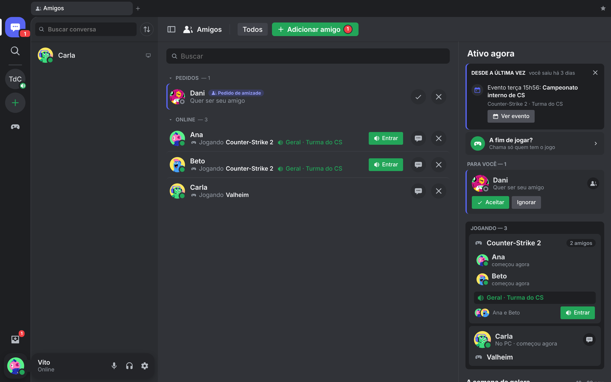
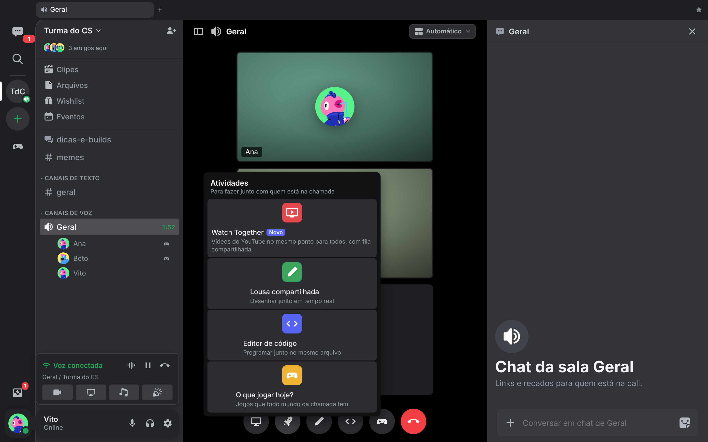
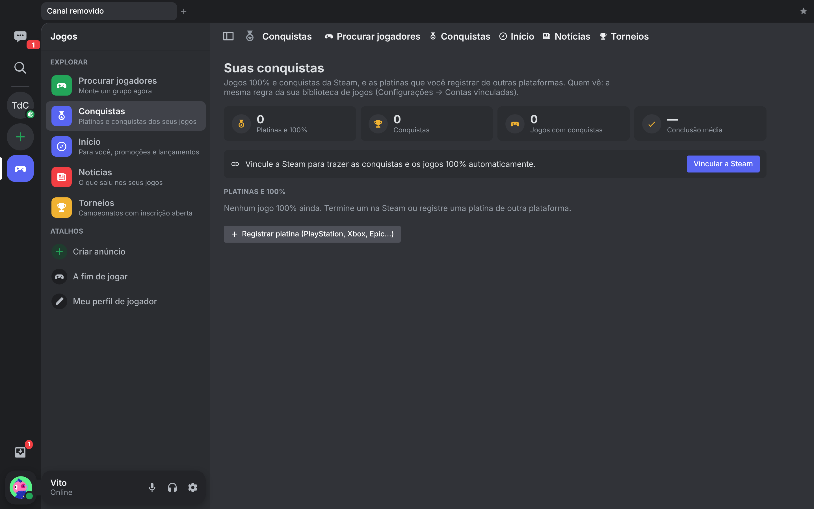

# Plano de evolução de produto do Resenha (22/11/2026)

Avaliação estratégica e criativa do Resenha como **produto**, não como código. Nada foi implementado nesta etapa: o único
arquivo novo além deste documento é a pasta de capturas `docs/plano-evolucao-produto/`.

**Como foi feito.** Quatro frentes em paralelo, consolidadas e conferidas pelo coordenador:
1. o app **rodando de verdade** (servidor local, 6 contas, um servidor "Turma do CS", chamada real com 3 pessoas, jogos
   simulados como nos testes), percorrido como usuário diário, com 40 capturas;
2. auditoria de memória, presença, Steam, LFG/intenções/eventos, notificações e clipes;
3. auditoria da experiência de chamada, transmissão, clipes, atividades e jogar junto;
4. pesquisa de referências externas (Discord, Steam, Medal, Strava, BeReal, Houseparty, Wordle, Twitch e outros), com fontes.

Também foram considerados o `HANDOFF-ESTRATEGICO-RESENHA.md`, o `docs/PROXIMOS-PASSOS.md`, os documentos de recursos e o
histórico do git.

**Legenda**
- **[OBSERVADO]**: visto no app rodando (com captura quando possível).
- **[VERIFICADO]**: conferido no código, com `arquivo:linha`.
- **[HIPÓTESE]**: inferência razoável, ainda não comprovada.
- **[PROPOSTA]**: ideia; não existe no código.

Limitações honestas: não tive acesso aos dados de uso de produção (`server/social.js` e `server/ux.js` registram retornos e
uso, mas só no servidor do dono), não testei nada no Windows, não vinculei Steam real e não gravei clipes de verdade.
O Descobrir só apareceu no estado de erro, porque o ambiente não alcança as fontes externas.

---

## Sumário

0. [A tese em uma página](#0-a-tese-em-uma-página)
1. [Diagnóstico sincero do produto atual](#1-diagnóstico-sincero-do-produto-atual)
2. [Principais problemas da experiência atual](#2-principais-problemas-da-experiência-atual)
3. [Oportunidades já dentro do código e da interface](#3-oportunidades-já-dentro-do-código-e-da-interface)
4. [28 ideias, com explicações concretas](#4-28-ideias-com-explicações-concretas)
5. [Referências e inspirações](#5-referências-e-inspirações)
6. [Ranking das oportunidades](#6-ranking-das-oportunidades)
7. [Três grandes propostas](#7-três-grandes-propostas)
8. [O Resenha em 6 meses](#8-o-resenha-em-6-meses)
9. [Recomendação: a próxima grande iniciativa](#9-recomendação-a-próxima-grande-iniciativa)
10. [O que descartar, adiar ou parar de fazer](#10-o-que-descartar-adiar-ou-parar-de-fazer)

---

## 0. A tese em uma página

**O Resenha foi construído como uma plataforma para desconhecidos, mas atende um grupo de dez amigos.**

Em 23 dias saíram 576 commits. O produto tem fórum estilo Reddit, canais de documento e de galeria, editor de código
compartilhado, notícias de 6 sites, torneios do Challengermode, um ranking de clipes com proteção contra fraude ponderada
em 35/25/25/15, 18 seções de configurações com cerca de 120 controles e um catálogo fixo de LFG. Quase tudo funciona e
muita coisa é tecnicamente impressionante. Por exemplo, a transmissão a 120 FPS, a recuperação do microfone e o jogar
junto com 4 controles estão acima do Discord.

Mesmo assim, faltam as três coisas que fazem um grupo pequeno **voltar** a um app:

1. **Um motivo para abrir com ninguém online.** A Home de quem chega sem a turma diz "Tudo quieto por aqui…". A memória
   do grupo começou a ser guardada há poucas horas e quase nada dela aparece na tela.
2. **Um jeito de chamar quem está com o app fechado.** Não existe push. Para o celular, o Resenha não existe.
3. **Diversão própria durante a chamada.** Dentro da call não há reação, não há nada coletivo e não há piada interna que
   o app guarde. É um Discord com vídeo melhor.

O Discord ganha pelo hábito e pela notificação. O Resenha não vai vencer pela qualidade do vídeo, porque ninguém troca de
app por 120 FPS. Pode vencer com algo que o Discord **estruturalmente não pode ter**: um lugar que **conhece este grupo
específico**, guarda a história dele para sempre e transforma cada noite de jogo num pequeno acontecimento.

> A proposta de identidade: **o Resenha é o lugar onde as noites da turma viram história.**
> O Discord é o telefone; o Resenha é o álbum, o bar e o placar da turma.

Por isso a próxima grande iniciativa recomendada é **"A Noite"**: cada sessão de voz vira um episódio com página própria,
linha do tempo, momentos, pérolas e "GG", entregue na manhã seguinte. Ela usa a memória que acabou de começar a ser
guardada, não depende do Windows nem de release do desktop, e alimenta a **Retrospectiva 2026** no dia 31/12. É um prazo
real, a 5 semanas. Em seguida vem **"Bora?" com aviso no celular**, que fecha o ciclo de chamar a turma. Detalhes nas
seções 7 e 9.

---

## 1. Diagnóstico sincero do produto atual

### 1.1 O que o Resenha faz muito bem

- **A chamada em si.** Entrar na sala é instantâneo [OBSERVADO]. A recuperação de rede e de microfone
  é robusta [VERIFICADO, `public/voice.js`, `public/micwatch.js`]. O painel "Sua voz" tem 4 níveis de redução de ruído,
  recomendação automática e diagnóstico ("Verificar problemas de voz") [OBSERVADO]. Os efeitos de voz são aplicados por
  quem ouve, então cada pessoa pode desligar o efeito dos outros (`public/voicefx.js:1-3`). O Discord não faz isso.
- **Transmissão de jogo.** 120 FPS pelo `lc-stream`, áudio só do jogo, oferta "Jogando X? Transmitir" [VERIFICADO,
  `public/share.js:300-316`] e prévia ao passar o mouse e mini-player [VERIFICADO, `public/livepip.js`].
- **Clipes das transmissões dos outros, ligados por padrão** (`public/settings.js:906`), com o aviso "Clipe salvo" por
  cima do jogo, sem roubar o foco (`desktop/clipflash.js`).
- **A Home com amigos ativos** é o melhor ponto da interface: "Jogando Counter-Strike 2 · Geral · Turma do CS" com
  **Entrar** na linha, agrupado por jogo [OBSERVADO, captura 04].
- **Busca rápida (Ctrl+K)**, chat sólido e importação de conversas do Discord [OBSERVADO/VERIFICADO].
- **Privacidade levada a sério**: regras de visibilidade (`canSee`), modo invisível, opção de sair do histórico, nada
  analisado por IA (`PRIVACIDADE.md`).

*Captura 04 [OBSERVADO]: o melhor estado do app. Amigos jogando, Entrar na linha, "Desde a última vez" e "Ativo agora".
Note também dois problemas: a faixa diz "você saiu há 3 dias" para uma conta criada segundos antes, e o pedido da Dani
aparece duas vezes.*

### 1.2 O que está errado na estratégia, não no código

**a) Largura no lugar de um ciclo.** O produto cresce por acúmulo de recursos ("o Discord tem X, o Steam tem Y, um plugin
faz Z") e não por um **ciclo de uso** claro: chamar a turma → jogar → guardar o que aconteceu → ter motivo para voltar.
Cada recurso é bom isoladamente, mas eles quase não conversam entre si. Três exemplos verificados:

- Há **três formas de dizer "vamos jogar"**: anúncio de LFG, "A fim de jogar" e evento. Todas terminam num convite para a
  chamada, mas **não se conhecem**: `server/events.js` não tem nenhuma referência a intenções [VERIFICADO]. Na aba Jogos,
  "Criar anúncio" e "A fim de jogar" ficam lado a lado sem diferença clara [OBSERVADO, captura 21].
- A sessão de voz guarda `event_id`, `intent_id`, `peak` e o que foi assistido (`server/sessions.js:107-122`), mas a
  interface não usa nada disso [VERIFICADO]. O evento de sexta acontece e o app não diz "rolou: 5 pessoas, 3h".
- As conquistas só avisam o próprio dono (`ACHIEVEMENTS_UPDATE` em `server/achievements.js:61,95,134`) [VERIFICADO]. Um
  amigo platina um jogo e ninguém fica sabendo.

**b) Pensado para desconhecidos, usado por amigos.** Vários sistemas resolvem problemas que um grupo de 10 não tem:

- o ranking de clipes se protege contra contas falsas, rajadas e loops (`docs/CLIPES-ENGAJAMENTO.md`) e exige "pelo
  menos 3 pessoas que assistiram de verdade". Na prática, a Home de um grupo pequeno mostra "Nenhum clipe se destacou
  ainda" [OBSERVADO, captura 03];
- o Descobrir puxa notícias, torneios abertos e mais vendidos da Steam: conteúdo genérico que qualquer site tem e que não
  diz nada sobre **este** grupo. É exatamente o "Activity Feed com notícias" que o próprio Discord removeu em 2020 por
  "não cumprir bem nenhum dos dois papéis" ([blog do Discord](https://discord.com/blog/tidying-up-discord));
- fórum com votos, editor de código, canais de documento: num grupo de amigos que joga, isso compete por atenção sem
  criar hábito [HIPÓTESE: só os dados de uso confirmam; vale olhar `server/ux.js` em produção].

**c) Engenharia sem prova no mundo real.** O que mais diferencia o Resenha, ou seja, 120 FPS, jogar junto, captura
WGC/DXGI e mouse travado, **nunca foi exercitado no Windows** (`HANDOFF` §2.3; `docs/REMOTE-PLAY.md` §6/§8). Não é
problema de código. É que nenhum amigo usou isso para jogar de verdade. Um recurso diferencial que ninguém viu funcionar
não diferencia nada.

**d) O roadmap só olha para dentro.** O `docs/PROXIMOS-PASSOS.md` (roadmap, linhas ~389-475) trata só de desempenho,
captura e Windows [VERIFICADO]. Nenhum item fala da experiência social. A sensação descrita pelo dono ("muito
concentrado em correções") tem base concreta.

**e) A direção certa já começou, mas ainda está invisível.** A iniciativa de memória (commits `35ef8b4` a `cd1560d`) foi a
decisão mais importante dos últimos dias. Só que até agora ela é **encanamento**:
- `activity_daily`, o único histórico de jogos que dura para sempre, é **gravado e nunca lido**: o grep só acha
  `CREATE` e `INSERT` (`server/activity.js:71,77`) [VERIFICADO];
- **as suas próprias sessões são escondidas de você**: `routes/sessions.js:24` exclui as sessões em que você esteve
  [VERIFICADO]. Não existe nenhuma tela de "nossas noites";
- o `PRIVACIDADE.md` promete "Tirar a sua participação", mas as rotas `DELETE /api/voice-sessions/:id/me` e
  `DELETE /api/voice-sessions/:id` **não têm botão** que as chame [VERIFICADO].

### 1.3 Respostas diretas às perguntas do pedido

| Pergunta | Resposta honesta hoje | O que mudaria a resposta |
|---|---|---|
| Por que alguém abriria o Resenha espontaneamente? | Para ver se alguém está jogando. Só isso, e só no PC. | A Noite de ontem para ver; um "Quem disse?" do dia; um aviso no celular. |
| Por que conversar pelo Resenha e não pelo Discord? | Melhor vídeo e áudio de jogo. Quem não transmite não sente diferença. | Diversão que só existe aqui (reações, pérolas, palpites, vinheta) e memória que o Discord não guarda. |
| O que mantém o app interessante quando ninguém está online? | Quase nada: "Nos últimos dias" e a semana da galera. | Memória com cara de álbum, jogos assíncronos com o próprio material do grupo, troféus. |
| Como deixar o jogar junto mais divertido? | Hoje é igual ao Discord, com clipe. | Camada de diversão na chamada (seção 7, proposta C). |
| Como transformar acontecimentos comuns em experiências compartilhadas? | O F8 existe, mas o clipe fica no aparelho por padrão. | Momentos coletivos, pérolas, a página da noite. |
| Como fazer o app parecer vivo sem chamada? | Não parece. | Retrato da turma, recados na sala, desafio da semana, "Bora?" com contador ao vivo. |
| O que podemos fazer que o Discord não faz? | Vídeo, áudio de jogo, jogar junto. | Memória ilimitada e própria do grupo, retrospectiva rica, piadas internas transformadas em recursos. |
| O que está subutilizado? | Desenho sobre a transmissão, lousa, "O que jogar hoje?", conquistas, `activity_daily`, sessões, importador do Discord. | Ver seção 3. |

---

## 2. Principais problemas da experiência atual

Ordenados pelo efeito sobre o usuário, não pela facilidade de correção.

1. **Sem push, o app não chama ninguém.** O `public/sw.js` só trata install/activate/fetch (linhas 9, 10 e 24)
   [VERIFICADO]. Convites de "A fim de jogar", lembretes de evento e convites para a chamada se perdem com o app fechado.
   Os convites para a chamada ainda **ficam só na memória e expiram em 5 min** (`server/callinvites.js:4,7`).
2. **Home vazia para quem chega sem a turma online, e sem integração para quem é novo.** A conta nova cai em
   "Ninguém por aqui ainda…". Entrar no servidor da turma fica num "+" sem rótulo, e o "Ativo agora" oferece "A fim de
   jogar?" para quem não tem nenhum amigo [OBSERVADO, captura 03].
3. **A memória do grupo é guardada e não aparece.** Ver 1.2 e. É o problema de maior potencial: os dados existem.
4. **"Desde a última vez" mente para quem é novo.** "Você saiu há 3 dias" numa conta de segundos, porque o padrão é
   `DEFAULT_AWAY` de 3 dias (`server/routes/sessions.js:10,18`) [OBSERVADO + VERIFICADO]. Além disso, a janela só avança
   quando a pessoa clica no X (`memory_seen` só é atualizado ali), então quem nunca dispensa vê sempre o mesmo resumo crescendo.
5. **Chamada com controles duplicados e diversão escondida.** Lousa, Editor de código e "O que jogar hoje?" aparecem no
   menu Atividades **e** como botões soltos ao lado (`public/stage.js:357-365`) [OBSERVADO, captura 12]. "Transmitir"
   está no painel e no palco, e mutar não está no palco. O melhor recurso social da chamada, **desenhar sobre a
   transmissão**, fica escondido no "⋯" (`share.js:357`). Não há **nenhuma reação** na chamada (nenhum op do gateway para
   isso) [VERIFICADO].
6. **O clipe nasce e morre no aparelho.** O destino padrão é "só este aparelho" (`clips.js:19`, `settings.js:928`), o
   aviso manda a pessoa ao "+ do campo de mensagem → Compartilhar um clipe" (`clips.js:80`), e **quem foi clipado não é
   avisado** [VERIFICADO]. A melhor matéria-prima de memória do grupo se perde por atrito.
7. **Peso de interface.** 18 seções de configurações, cerca de 120 controles (só "Sons" tem 27) e "Novidades" com ~8.200
   palavras [OBSERVADO]. Uma barra de abas estilo navegador ocupa espaço em todas as telas sem função clara
   [OBSERVADO]. O app Jogos tem 5 abas, 3 atalhos e a navegação duplicada no topo [OBSERVADO, captura 21].
8. **Identidade visual das pessoas fraca.** Ana e Vito têm o mesmo avatar padrão e a mesma cor. No chat e na chamada
   parece a mesma pessoa [OBSERVADO, captura 10].
9. **Recursos da Steam terminam em beco sem saída** para quem não vincula: Conquistas vazias e "O que jogar hoje?"
   vazio. "O que jogar hoje?" só funciona **dentro** da chamada (`server/games.js:251` devolve 403) [VERIFICADO].
10. **Celular de segunda classe.** "Adicionar ami…", "Jogando C…" cortados e sem navegação inferior [OBSERVADO, captura 34].
    Somado à falta de push, o celular não serve para nada além de ler o chat.
11. **Rótulos errados ou confusos**: aba "Canal removido" em Conquistas, "Sem cargo · 5º de 5", badge de pedido de
    amizade no botão "Adicionar amigo" e "Avisar quando alguém desfizer a amizade" **ligado** por padrão, o que é
    socialmente arriscado [OBSERVADO].

*Captura 12 [OBSERVADO]: o menu Atividades repete os três botões que já estão na barra logo abaixo. "Editor de código"
num app de turma de jogo é um sintoma de largura sem foco.*

*Captura 21 [OBSERVADO]: aba "Canal removido", navegação repetida no topo, "Criar anúncio" e "A fim de jogar" lado a lado,
e o estado vazio quando não há Steam vinculada.*

---

## 3. Oportunidades já dentro do código e da interface

Coisas que **já existem**, total ou parcialmente, e estão invisíveis, desconectadas ou sem uso. É aqui que o melhor
custo-benefício está.

| # | O que já existe | Onde | O que vira com pouco esforço | Tipo |
|---|---|---|---|---|
| 1 | Sessões de voz permanentes com membros, jogos, clipes, vídeos, evento e intenção | `server/sessions.js:35-44,107-122` | A página "A Noite" (ideia 1) e "Nossas noites" no perfil | Nova experiência sobre base pronta |
| 2 | `activity_daily`: jogos por pessoa e dia, para sempre, nunca lido | `server/activity.js:71-80` | "Faz 3 meses que vocês não jogam Valheim", retrospectiva, troféus, "Nesta data" | Incremental |
| 3 | Rotas de apagar a própria participação, sem botão | `server/routes/sessions.js:64-74` | Cumprir a promessa do `PRIVACIDADE.md` | Correção de confiança |
| 4 | **Importador do Discord** (até 50.000 mensagens por vez, na data original) | `public/importer.js`, `server/importer.js` | Anos de história da turma **dentro** do Resenha: "Nesta data" e "Quem disse?" funcionando **desde o primeiro dia** | Nova experiência [HIPÓTESE: depende de o grupo exportar o histórico antigo] |
| 5 | Desenho sobre a transmissão (`ROOM_DRAW`) e lousa | `public/board.js`, `share.js:357` | "Apontar" na tela do amigo: seta e marcação que somem sozinhas, com botão visível | Incremental |
| 6 | "O que jogar hoje?" cruzando bibliotecas, com sorteio e enquete | `public/games.js:241`, `server/games.js:250-275` | Fora da chamada e na decisão do "Bora?" | Incremental |
| 7 | Soundboard com atalho global e som que entra nos clipes | `public/soundboard.js`, `desktop/main.js:280-292` | Clipe vira som; vinheta de entrada | Nova experiência pequena |
| 8 | Recorte exato de clipe | `public/cliptrim.js` | Base do "clipe vira som" | Reuso |
| 9 | Mensagens de voz | `public/voicenote.js` | Recado deixado na sala de voz | Nova experiência pequena |
| 10 | Pílula por cima do jogo, sem foco e fora da captura | `desktop/clipflash.js` | Overlay mínimo: reações, pedidos para jogar, quem fala | Nova experiência |
| 11 | `ach_unlocks` / `ach_info` com raridade | `server/achievements.js:31-40` | Conquista rara vira acontecimento do grupo com "GG" | Incremental |
| 12 | "Destacar para todos" (`ROOM_SPOTLIGHT`) | `server/index.js:1118-1125` | "Olha isso!" com um clique durante a call | Incremental |
| 13 | Ganchos de evento, intenção, LFG e convite que terminam todos em convite para a call | `server/events.js`, `intents.js`, `lfg.js:121`, `callinvites.js` | Unificar no "Bora?" (ideia 8) | Simplificação |
| 14 | Agendador de segunda-feira e "A semana da galera" | `server/ux.js:205-212`, `server/activity.js:249-294` | Ritual "Resenha da semana" publicado num canal | Incremental |
| 15 | Webhook ntfy (só para o admin hoje) | `server/alerts.js` | Primeiro aviso no celular por pessoa, sem infraestrutura nova | Incremental |
| 16 | Temas compartilháveis por código e editor ao vivo | `public/themeeditor.js` | "Tema da turma" vinculado ao servidor, como identidade | Incremental |

**Pequenas mudanças com impacto grande na percepção** (todas P, ou seja, até 3 dias):
- Card central "Entre no servidor da sua turma" com o campo de convite na Home de quem não tem servidor.
- "Desde a última vez" só depois da primeira visita real, ou "Bem-vindo" na primeira vez; avançar a janela também ao ver, não só ao dispensar.
- Tirar os botões duplicados da barra da chamada, levar mutar e ensurdecer para o palco e usar grade de 2 colunas com o chat aberto.
- Avatar e cor padrão diferentes por pessoa.
- "Compartilhar com a turma" direto no aviso do F8.
- Botão visível "Desenhar" no quadro da transmissão.
- Título do Watch Together e música atual na linha da sala.
- "Avisar quando alguém desfizer a amizade" desligado por padrão.

---

## 4. 28 ideias, com explicações concretas

Agrupadas por direção. Cada uma indica se é **incremental** (melhora algo que existe) ou **nova experiência**. Esforço para
uma pessoa: **P** até 3 dias, **M** de 4 a 10 dias, **G** mais de 10. Manutenção: baixa, média ou alta.

### A. Memória e momentos: "as noites viram história"

#### 1. A Noite: cada sessão vira um episódio (nova experiência) ★
- **Problema:** a memória existe e não aparece. A chamada acaba e não sobra nada.
- **Experiência:** ao fim de cada sessão com 3+ pessoas e mais de 30 min, nasce uma página "A Noite de sexta, 21/11",
  aberta a partir do "Desde a última vez", do perfil, da Home e de um link no canal. Ela traz:
  - um título automático, feito por regras e não por IA (ex.: "4h12 de CS2 e um Valheim de saideira");
  - quem esteve e por quanto tempo;
  - a **linha do tempo** com entradas, jogos, clipes, sons do soundboard mais tocados, vídeos do Watch Together, músicas,
    conquistas destravadas e pérolas;
  - os **momentos** da noite (ideia 2) e o "lance da noite", o clipe mais curtido;
  - "GG" e comentários.

  Na manhã seguinte, quem esteve recebe "A Noite de ontem está pronta", e quem faltou recebe "Você perdeu: …".
- **Por que alguém usaria:** é o "você viu ontem?" do grupo, materializado. Quem foi revive; quem faltou sente vontade de ir
  na próxima.
- **O que a torna diferente:** o Discord não guarda nada disso. O Strava faz exatamente isso com corridas, e a página da
  atividade é o centro do app ([Strava](https://medium.com/strava-design/understanding-how-athletes-use-the-feed-aae986eaa818)).
  A linha do tempo vem do Steam Timeline ([PC Gamer](https://pcgamer.com/software/platforms/steam-game-recording-is-now-available-for-everyone-and-its-packed-with-neat-features)).
- **Viabilidade:** alta. `voice_sessions`, `voice_session_members`, `summary`, clipes por canal e horário, `watch_history`,
  `ach_unlocks` e `canSee` já existem. Falta gravar no fechamento os ids dos clipes e alguns eventos da linha do tempo, uma
  rota de leitura e a página. **M.** Manutenção baixa a média.
- **Dependências e dificuldades:** privacidade (a mesma regra do "Desde a última vez": quem está invisível aparece como "+1",
  e quem desligou o histórico fica de fora); a música hoje é sempre 0 no resumo (`sessions.js:115`); os eventos da linha do
  tempo precisam ser gravados com poucas escritas.

#### 2. Momentos coletivos: F8 em grupo (nova experiência)
- **Problema:** o clipe é individual e fica no aparelho.
- **Experiência:** quando 2+ pessoas apertam F8 em até ~20 s na mesma sala, o app junta os clipes num **Momento** com os
  ângulos de cada um, vira destaque da Noite e avisa quem foi clipado: "Ana e Beto clicaram o seu clutch".
- **Por que alguém usaria:** apertar F8 ao mesmo tempo é a forma mais honesta de dizer "isso foi épico", e quem foi clipado
  ganha reconhecimento.
- **O que a torna diferente:** o Medal e o NVIDIA Highlights detectam por jogo. O Resenha detecta pelo grupo, com
  consentimento e em qualquer jogo.
- **Viabilidade:** agrupar é fácil (`clips.streamer_id`, `channel_id`, `created_at`). O problema é o clipe local:
  o Momento precisa subir os clipes envolvidos. A proposta é perguntar uma vez "Enviar seus clipes de momentos para a
  turma?". **M.** Manutenção média.
- **Dependências:** buffer da própria transmissão desligado por padrão (`settings.js:906`). Reavaliar medindo; o custo já
  caiu para ~+0,5 ponto de CPU (`2c676a7`).

#### 3. Livro de pérolas (nova experiência)
- **Problema:** as melhores frases do grupo se perdem no rolar do chat.
- **Experiência:** no menu da mensagem, "Guardar como pérola", ou uma reação reservada 📜. A mensagem entra num mural
  ("Pérolas da turma") com autor, data e, se foi durante uma sessão, um link para a Noite. O autor pode retirar.
- **Por que alguém usaria:** é a fábrica de piadas internas, e alimenta "Quem disse?" (ideia 22), a Retrospectiva e os
  troféus.
- **O que a torna diferente:** no Discord, isso exige bot externo ("starboard"). Aqui é nativo e se conecta ao resto.
- **Viabilidade:** muito alta. Mensagens, reações e FTS já existem. **P.** Manutenção baixa.

#### 4. Clipe vira som (nova experiência pequena)
- **Experiência:** no player do clipe, "Virar som": escolhe 1 a 5 s e o trecho entra no soundboard do servidor, com
  crédito ("de um clipe de 21/11").
- **Por que alguém usaria:** o grito do Beto vira o som que todo mundo toca por meses. É assim que nasce cultura de grupo.
- **Viabilidade:** `cliptrim.js` mais `addSound` (`soundboard.js:127-140`). Exige aliviar a permissão: hoje os sons do
  servidor pedem MANAGE_GUILD (`routes/emojis.js:28`). A proposta é deixar qualquer membro adicionar, com limite por
  pessoa. **P/M.** Manutenção baixa.

#### 5. Nesta data, com o histórico importado do Discord (incremental com potencial alto)
- **Experiência:** na Home, "Há 2 anos: vocês mandaram 412 mensagens nesse dia; a pérola foi…" e "Há 1 mês: 3h de Valheim
  com Ana, Beto e Carla".
- **O ponto que ninguém notou:** o `importer.js` já leva conversas do Discord para a data original. Se a turma importar o
  canal principal antigo, o "Nesta data" funciona **hoje**, sem esperar um ano de dados [HIPÓTESE: depende de o dono
  exportar com o DiscordChatExporter]. Vira também um argumento de migração: "traga a história de vocês".
- **Viabilidade:** alta. Mensagens por data mais `voice_sessions` e `activity_daily`. **P.** Opção "não mostrar este dia";
  excluir quem saiu (`friend_losses`).
- **Referência:** o Memories do Google Photos, que o Google diz ter mais de 500 milhões de usuários por mês ([TechCrunch](https://techcrunch.com/2023/08/15/google-photos-adds-a-scrapbook-like-memories-view-feature-aided-by-ai)).

#### 6. Retrospectiva 2026 da turma (nova experiência, com prazo)
- **Experiência:** no dia 31/12, uma sequência de cartões no estilo Wrapped: horas juntos, a noite mais longa, a dupla que
  mais jogou junta, o jogo que uniu mais gente, o clipe do ano, a pérola do ano, o som mais tocado, os troféus. Um cartão
  por pessoa, com o lado bom ("o que mais chamou a galera"), nunca "quem menos apareceu".
- **Por que agora:** existe um prazo real. O Discord lançou o Checkpoint em dezembro de 2025 ([blog](https://discord.com/blog/checkpoint-2025-discord-year-in-review)).
  Se o Resenha não fizer a sua, a turma vai ver a do Discord.
- **Limitação honesta:** as sessões só existem desde 22/11 e as `activities` cobrem 30 dias (preenchimento retroativo de
  `activity_daily`). Para mensagens, reações e clipes, há todo o histórico do Resenha, mais o importado do Discord, se
  houver. A versão 2026 é uma "retrospectiva do primeiro ano da Resenha". A de 2027 será completa.
- **Viabilidade:** **M.** Cartões em HTML gerados no servidor a partir de dados concretos. **Sem texto de IA**: a crítica
  ao Wrapped de 2024 foi justamente trocar dados por geração automática ([TechCrunch](https://techcrunch.com/2024/12/04/spotify-users-are-disappointed-by-an-underwhelming-wrapped-this-year)).

#### 7. Troféus da turma (nova experiência)
- **Experiência:** qualquer pessoa cria um troféu ("Rei do clutch", "Morreu para o próprio C4", "Ficou até as 5h") e
  propõe dar a alguém. Com 2 votos de outros, ele é concedido e aparece no perfil e na Noite em que aconteceu. Quem recebe
  pode esconder.
- **Por que alguém usaria:** é identidade e piada interna transformadas em objeto. Ninguém faz isso pelo grupo; o grupo
  faz para si.
- **O que a torna diferente:** as conquistas da Steam são da Valve; estas são da turma.
- **Viabilidade:** alta. Tabela nova, voto e cartão no perfil. **P/M.** Risco de constrangimento, mitigado pela regra de
  votos e pelo esconder.

### B. Trazer a turma de volta

#### 8. "Bora?": um botão para chamar a turma (nova experiência e simplificação) ★
- **Problema:** LFG, "A fim de jogar", evento e convite são quatro formas de dizer a mesma coisa, e nenhuma alcança o
  celular.
- **Experiência:** um único botão "Bora?" na Home, na sala e no celular. A pessoa escolhe o jogo **ou** "só resenhar",
  e o horário: agora, 21h ou outro. Na mesma hora, a turma recebe um aviso com **contador ao vivo**:
  "Bora CS2 às 21h? 3/5 topam: Ana, Beto, você?". As respostas são **Tô dentro / Mais tarde / Hoje não**. Quando o
  número mínimo bate, o cartão vira "Formou! Sala Geral" com Entrar, e quem respondeu "mais tarde" recebe lembrete.
  Se for marcado para outro dia, vira evento sozinho. LFG e "A fim de jogar" passam a ser **modos** do Bora, não
  abas diferentes.
- **Por que alguém usaria:** "bora?" já é o que todo mundo manda no grupo do WhatsApp. O Resenha só transforma isso num
  objeto com contador, e quem se compromete aparece.
- **O que o torna diferente:** o Discord não tem nada parecido; o "Ping @everyone" é barulho sem estrutura. O contador
  ao vivo resolve a lição do Clubhouse e do Houseparty: presença precisa de motivo e de previsão ("Pedro e Ana entram
  às 21h").
- **Viabilidade:** a maior parte existe (`server/intents.js` com formação e "mais tarde", `events.js` com RSVP e
  lembretes, convites). O grosso do trabalho é unificar a interface e permitir intenção sem jogo (hoje recusada em
  `intents.js:54`). **M.** Manutenção **reduz** com o tempo, porque são três sistemas virando um.

#### 9. Aviso no celular (habilitador)
- **Experiência:** os avisos que **importam** chegam ao celular: "Bora?" que formou ou que chamou você, "A Noite de ontem
  está pronta", convite direto para a call, evento em 15 min, "Ana clicou você". Há um orçamento de avisos (ex.: até 3
  por dia, salvo convite direto) e horário de silêncio.
- **Viabilidade:** fase 1 com **ntfy** por pessoa (tópico próprio), reaproveitando `server/alerts.js`. Fase 2 com Web Push
  (VAPID, HTTPS válido e, no iPhone, a PWA instalada) [HIPÓTESE: o certificado da Tailscale resolve o HTTPS].
  **P → M.** Manutenção média.
- **Por que aparece "só" em 4º no ranking:** por si só, o push não diferencia nada. Ele **multiplica** o resto. Sem
  conteúdo bom (Noite, Bora), vira ruído e é silenciado. Por isso vem colado às ideias 1 e 8, não antes delas.

#### 10. Recado na sala (nova experiência pequena)
- **Experiência:** quem sai da sala pode deixar um recado de voz de até 20 s ("amanhã tem revanche, ninguém foge").
  Quem entra na sala vazia ouve o recado ou o vê no topo do chat da sala.
- **Por que alguém usaria:** a sala vazia passa a ter vestígios de vida. É o Marco Polo aplicado ao lugar, não à pessoa.
- **Viabilidade:** `voicenote.js` já grava; falta anexar o recado à sala e tocá-lo ao entrar. **P.**

#### 11. Integração da turma, para quem é novo (incremental)
- **Experiência:** convite → nome e avatar distinto → "Vincule a Steam para o 'O que jogar hoje?' funcionar" → cai direto
  na Home com a turma, a última Noite e as pérolas. Sem tela de "Ninguém por aqui".
- **Viabilidade:** **P.** Pouca frequência, mas é a primeira impressão de cada novo amigo.

#### 12. Resenha da semana, o ritual de segunda (incremental)
- **Experiência:** segunda às 10h, um cartão publicado num canal escolhido e enviado como aviso: noites da semana, jogo da
  semana, lance da semana, pérola da semana, troféus concedidos e o "Bora?" que mais juntou gente.
- **Viabilidade:** agendador e `weekFor` existem. **P.** Depende das ideias 1 e 3 para ter conteúdo.

### C. Durante a chamada e as partidas

#### 13. Reações na chamada e na transmissão (nova experiência pequena) ★
- **Experiência:** teclas rápidas ou uma barra discreta para mandar 😂 🔥 💀 GG "KKKK", que flutuam no quadro da pessoa ou
  na transmissão. Quem transmite em tela cheia vê as reações como pílulas pelo overlay mínimo. As reações entram na linha
  do tempo da Noite e, quando a sala "explode" (3+ reações em 5 s), marcam um **pico** que sugere "Clipar?".
- **Por que alguém usaria:** quem assiste a transmissão hoje é passivo. Uma reação é a forma mais barata de participar sem
  falar por cima do jogo.
- **Viabilidade:** novo op `ROOM_REACT` copiando o padrão e o limite do `SOUNDBOARD` (`server/index.js:1091-1097`), mais
  a animação. **P.** Manutenção baixa.

#### 14. Overlay sem injeção (nova experiência)
- **Problema:** em tela cheia, o jogador não vê quem fala, pedidos para jogar, convites ou reações.
- **Experiência:** uma janela transparente, sem foco e fora da captura, com quem está falando (avatares pequenos num
  canto), "Fulano pediu para jogar · Aceitar (Alt+Y)", reações e o aviso de mudo. É opcional e configurável.
- **O que a torna diferente:** o overlay do Discord se injeta no jogo e briga com anti-cheat. O redesenho de 2025 foi
  justamente para widgets mais leves ([blog](https://discord.com/blog/redesigning-the-discord-overlay)).
- **Viabilidade:** a técnica já existe em `desktop/clipflash.js:55-65`. Limitações: não funciona em tela cheia exclusiva,
  só em "janela sem bordas"; exige release do desktop e teste no Windows. **M/G.** Manutenção média.
- **Decisão a revisar:** o app hoje se orgulha de "não ter overlay" (`public/lite.js:148`). Isso era verdade para um
  overlay injetado. Um overlay de janela não pesa e resolve um problema real.

#### 15. Palpites: o bolão da turma (nova experiência)
- **Experiência:** durante uma transmissão ou antes de uma partida, qualquer pessoa abre um palpite ("O Beto passa dos 20
  kills?", "Ganhamos essa?", "Quem morre primeiro?"). A turma aposta **resenhas**, uma moeda fictícia que todo mundo
  recebe semanalmente e que não compra nada. Quem abriu resolve, e o resultado entra na Noite. Há um placar semanal de
  palpites, não de pessoas no jogo.
- **Por que alguém usaria:** quem está assistindo ganha algo em jogo, e quem está jogando ganha pressão divertida. Combina
  com a cultura brasileira do bolão.
- **Referência:** Twitch Predictions ([Twitch](https://blog.twitch.tv/en/2020/12/12/channel-points-predictions-let-your-viewers-guess-your-destiny)).
- **Viabilidade:** sem integração com jogos, a resolução é manual. Base nas enquetes (`polls.js`). **M.**
  **Riscos:** parecer aposta. Por isso a moeda não tem valor e não é comprada. Também pode ser chato se usado demais;
  limitar a 1 palpite aberto por sala.

#### 16. Vinheta de entrada (nova experiência pequena)
- **Experiência:** cada pessoa escolhe um som de até 3 s, tirado do soundboard ou de um clipe, que toca quando ela entra
  na sala. Cada um pode desligar as vinhetas dos outros.
- **Por que alguém usaria:** é identidade, é engraçado e é zero esforço depois de configurado. O Discord cobra Nitro por
  algo parecido.
- **Viabilidade:** o sistema de sons de entrada e saída já trata quedas e reconexões sem tocar som falso
  (`public/sounds.js:96-97`). **P.**

#### 17. Apontar na tela do amigo (incremental)
- **Experiência:** botão visível "Apontar" no quadro da transmissão: um clique desenha um círculo ou seta que some em 3 s,
  com o nome de quem apontou. Para quem transmite em tela cheia, aparece pelo overlay.
- **Por que alguém usaria:** "ali, ó, atrás da caixa": coaching e ajuda em puzzle.
- **Viabilidade:** `ROOM_DRAW` e `annotTools` existem. Só falta a forma efêmera e o botão visível. **P.**

#### 18. Clipe: compartilhar agora e avisar quem foi clipado (incremental)
- "Mandar para a turma" no próprio aviso do F8 e "Ana clicou você" para quem transmitia. **P.** Condição para Momentos e
  para a Noite terem material.

#### 19. Jogar junto em 1 clique (nova experiência, depois da validação)
- **Experiência:** um cartão na sala: "Beto abriu Overcooked · 2 vagas · Entrar como Player 2".
- **Viabilidade:** depende da **validação com 2 PCs**, que ainda não aconteceu (`docs/REMOTE-PLAY.md` §8). **M.**
  Manutenção alta, por causa do ViGEmBus, driver de terceiro.
- **Opinião:** é o recurso mais "uau" do Resenha. Hoje ele é uma promessa. A validação deveria virar um **evento social**:
  uma "Noite de teste" com a turma, que já produz a primeira Noite e os primeiros Momentos.

#### 20. "O que a gente joga?" fora da call, com memória (incremental)
- **Experiência:** na Home e no "Bora?": "Vocês 4 têm Deep Rock Galactic; faz 3 meses que não jogam", "Lethal Company
  está 60% off e 3 de vocês querem".
- **Viabilidade:** `game_library`, `wishlist`, promoções e `activity_daily` (que finalmente teria leitura). **P/M.**

#### 21. Conquistas como acontecimento (incremental)
- Conquista rara (< ~5%) de um amigo vira item no "Desde a última vez" e na Noite, com "GG" em um clique.
  Limitação: a Steam sincroniza a cada ~24 h, e o perfil precisa ser público (`achievements.js:28`). **P.**

### D. Entretenimento assíncrono: o app vivo sem ninguém online

#### 22. "Quem disse?": o desafio diário da turma (nova experiência) ★
- **Problema:** com ninguém online, não há o que fazer no app.
- **Experiência:** uma rodada por dia, igual para todos, que leva menos de 1 minuto. Três formatos se alternam:
  - **Quem disse?** Uma pérola ou mensagem antiga muito reagida, sem o nome, com 4 opções.
  - **Que jogo é esse?** Um quadro de um clipe da turma.
  - **Quando foi isso?** Uma foto ou clipe antigo; acerta o mês.

  O resultado é compartilhável como um grid de emojis no chat, e há uma sequência **do grupo** ("a turma acertou 12 dias
  seguidos"), nunca individual.
- **Por que alguém usaria:** usa o próprio material do grupo, que é o único conteúdo que ninguém mais tem, e provoca
  conversa ("quem disse isso foi o Caio em 2023, KKKKK").
- **Referências:** Wordle, pelo grid compartilhável que não entrega a resposta ([Game Developer](https://www.gamedeveloper.com/marketing/josh-wardle-reflects-on-the-the-unconventional-road-to-wordle-s-success)),
  e o desafio assíncrono do GeoGuessr. Anti-lição do BeReal: é opcional e não cobra ninguém.
- **Viabilidade:** **M.** Gerado no servidor a partir de mensagens com muitas reações, pérolas e clipes. Fica **muito
  melhor com o histórico do Discord importado**.
  **Cuidados:** nunca usar mensagens de DM; respeitar mensagens apagadas e quem saiu; deixar cada um tirar as próprias
  mensagens do sorteio.

#### 23. Desafio coletivo da semana (nova experiência)
- **Experiência:** "Desafio da semana: 3 de vocês terminam uma partida de It Takes Two juntos" ou "A turma soma 10 horas
  de Valheim". O progresso aparece na Home, e a recompensa é cosmética: uma moldura de avatar ou um troféu da turma.
- **Por que:** uma meta compartilhada dá motivo para marcar o "Bora?". É a parte boa das Quests do Discord, sem anúncio
  ([blog](https://discord.com/blog/celebrating-one-year-of-quests)).
- **Viabilidade:** `activity_daily`, sessões e `ach_unlocks`. Desafios escolhidos de uma lista ou sugeridos pela turma.
  **M.**

#### 24. GG com um toque (incremental, transversal)
- Um "GG" universal em Noites, clipes, conquistas, troféus e pérolas. É o kudos do Strava: o reconhecimento mais barato
  que existe, e funciona melhor entre amigos próximos ([Running Magazine](https://runningmagazine.ca/?p=91520)). **P.**

### E. Identidade e personalização

#### 25. Identidade da turma (incremental)
- Tema da turma vinculado ao servidor (o editor de temas já existe), avatares padrão distintos, "lore" no perfil do
  servidor (pérolas fixadas, troféus mais famosos, a primeira Noite) e um nome de "temporada" ("Temporada Valheim,
  nov/2026"). **P/M.** Valor emocional alto, frequência baixa.

#### 26. Simplificação ("faxina") como recurso (incremental, subtração)
- Esconder atrás de "Recursos extras" o que não serve à turma: Descobrir (notícias e torneios), editor de código, canais
  de documento, abas estilo navegador. Também reduzir as Configurações para as ~30 opções essenciais, com "Avançado" para o
  resto. **P/M.** Diminui manutenção e confusão.
  [HIPÓTESE: os dados de uso do servidor do dono dizem o que cortar com segurança; olhar `server/ux.js` antes.]

### F. Inteligência artificial (só onde agrega)

#### 27. Narrador opcional da Noite (adiar)
- Um título engraçado e uma legenda curta para a Noite, gerados **só a partir dos dados estruturados**: nunca do áudio,
  nunca das DMs. Seria opcional e ligado pelo dono do servidor.
- **Por que adiar:** o `PRIVACIDADE.md` promete que nada é analisado por IA no servidor. Os casos do Apple Intelligence e
  do Zoom AI mostram que resumo automático errado entre amigos gera briga ([TechCrunch](https://techcrunch.com/2025/01/16/apple-pauses-ai-notification-summaries-for-news-after-generating-false-alerts)).
  Títulos por regras ("4h de CS2 e um Valheim de saideira") entregam 80% do valor sem risco. Reavaliar depois que a
  Noite provar valor.

#### 28. Pico da sala como sugestão de clipe (experimental)
- Quando o volume da chamada explode (todo mundo gritando ao mesmo tempo) ou chegam 3+ reações em poucos segundos, o app
  sugere "Clipar os últimos 30 s?" para quem tem o buffer ligado. **Não grava nada sozinho.**
- É a ideia de "detecção de risadas" do handoff, só que sem gravação contínua e com decisão humana.
- **Viabilidade:** o `AudioLevelObserver` do SFU já existe (`server/sfu.js:201-207`). Calibrar falsos positivos é o
  trabalho. **M.** Experimental: só depois das reações.

---

## 5. Referências e inspirações

| Referência | O que funcionou ou falhou | Como traduzir para o Resenha |
|---|---|---|
| Strava (feed, kudos) | A página da atividade e o kudos levam a correr mais; o efeito vem dos amigos próximos | A Noite como "atividade" do grupo e o GG |
| Steam Timeline (2024) | Marcadores automáticos e manuais na gravação | A linha do tempo da Noite |
| Medal / NVIDIA Highlights | Clipe automático por evento do jogo; caro de manter por jogo | Momentos por F8 coletivo e pico da sala, independentes do jogo |
| Google Photos Memories / Snapchat Memories | Lembranças são um ativo emocional; cobrar por elas gerou revolta | "Nesta data"; prometer "a memória é de vocês, nunca apaga" |
| Discord Checkpoint (2025) / Spotify Wrapped | Retrospectiva com dados concretos se compartilha; texto de IA decepciona | Retrospectiva 2026 só com dados reais |
| Discord Activity Feed (removido em 2020) | Feed automático e genérico vira lixo | Mostrar só eventos sociais; repensar o Descobrir |
| Overlay do Discord (2025) | Overlay injetado pesa; widgets leves agradam | Overlay de janela, mínimo |
| Twitch Predictions | Espectador com algo em jogo | Palpites com moeda fictícia |
| Wordle / GeoGuessr | Rodada única diária, resultado compartilhável que não entrega a resposta | "Quem disse?" |
| Discord Quests | Desafio com prazo e recompensa | Desafio coletivo da semana, sem anunciante |
| Marco Polo | Assíncrono sem pressão | Recado deixado na sala |
| Houseparty, Clubhouse, Gather (social) | Presença sem motivo morre | "Bora?" com contador e previsão de quem vem |
| BeReal | Ritual diário obrigatório cansa (queda de cerca de 61% em DAU, dado contestado) | Nada de sequência individual nem cobrança |
| Clyde (Discord) | Bot de IA como "membro" não agrega e gera risco | Nada de chatbot; IA só como narrador opcional, depois |
| Steam Remote Play Together | Validou "só o anfitrião precisa do jogo" | Jogar junto em 1 clique, depois de validado |

Fontes completas no relatório de pesquisa. As principais estão citadas inline na seção 4.

---

## 6. Ranking das oportunidades

Critérios do pedido, de 1 a 5 (5 = melhor). Em **Custo**, 5 significa barato de fazer e manter. Pesos: impacto 25%,
diferenciação 20%, frequência 15%, engajamento e volta 20%, viabilidade 10%, custo 10%. Os pesos favorecem de propósito
o que muda a experiência, não o que é fácil.

| # | Ideia | Impacto | Difer. | Freq. | Engaj. | Viab. | Custo | **Nota** | Tipo |
|---|---|---|---|---|---|---|---|---|---|
| 1 | **A Noite** (episódio da sessão) | 5 | 5 | 4 | 5 | 4 | 4 | **4,65** | Nova |
| 2 | **Livro de pérolas** | 4 | 4 | 4 | 4 | 5 | 5 | **4,20** | Nova |
| 3 | **Quem disse?** (desafio diário) | 4 | 5 | 4 | 4 | 3 | 4 | **4,10** | Nova |
| 4 | **Aviso no celular** | 5 | 2 | 5 | 5 | 3 | 3 | **4,00** | Habilitador |
| 5 | **Bora?** (unifica LFG, intenção, evento e convite) | 4 | 3 | 4 | 5 | 4 | 3 | **3,90** | Nova e simplificação |
| 6 | Momentos coletivos (F8 em grupo) | 4 | 5 | 3 | 4 | 3 | 3 | 3,85 | Nova |
| 7 | Retrospectiva 2026 | 5 | 4 | 1 | 4 | 4 | 4 | 3,80 | Nova, com prazo |
| 8 | Palpites (bolão) | 3 | 5 | 3 | 4 | 4 | 4 | 3,80 | Nova |
| 9 | Reações na chamada | 4 | 2 | 5 | 3 | 5 | 5 | 3,75 | Nova pequena |
| 10 | Troféus da turma | 3 | 5 | 2 | 4 | 4 | 4 | 3,65 | Nova |
| 11 | Overlay sem injeção | 4 | 4 | 5 | 3 | 2 | 2 | 3,55 | Nova |
| 12 | Vinheta de entrada | 3 | 3 | 4 | 3 | 5 | 5 | 3,55 | Nova pequena |
| 13 | GG com um toque | 3 | 2 | 4 | 4 | 5 | 5 | 3,55 | Incremental |
| 14 | Nesta data (com o histórico do Discord) | 3 | 4 | 3 | 3 | 4 | 5 | 3,50 | Incremental |
| 15 | Clipe vira som | 3 | 4 | 3 | 3 | 4 | 4 | 3,40 | Nova pequena |
| 16 | Desafio coletivo da semana | 3 | 4 | 3 | 4 | 3 | 3 | 3,40 | Nova |
| 17 | Faxina e simplificação | 4 | 2 | 5 | 2 | 4 | 4 | 3,35 | Subtração |
| 18 | Clipe: compartilhar agora e avisar quem foi clipado | 3 | 2 | 4 | 3 | 5 | 5 | 3,35 | Incremental |
| 19 | Jogar junto em 1 clique | 4 | 5 | 2 | 3 | 2 | 2 | 3,30 | Nova, bloqueada |
| 20 | Recado na sala | 3 | 4 | 2 | 3 | 4 | 4 | 3,25 | Nova pequena |
| 21 | "O que a gente joga?" com memória | 3 | 3 | 3 | 3 | 4 | 4 | 3,20 | Incremental |
| 22 | Conquistas como acontecimento | 3 | 3 | 3 | 3 | 4 | 4 | 3,20 | Incremental |
| 23 | Resenha da semana (segunda) | 3 | 3 | 2 | 3 | 5 | 5 | 3,20 | Incremental |
| 24 | Integração da turma (novos) | 4 | 1 | 1 | 3 | 5 | 5 | 2,95 | Incremental |
| 25 | Apontar na tela | 2 | 4 | 3 | 2 | 4 | 4 | 2,95 | Incremental |
| 26 | Narrador de IA | 3 | 3 | 3 | 3 | 3 | 2 | 2,90 | Adiar |
| 27 | Pico da sala sugere clipe | 3 | 4 | 3 | 2 | 2 | 3 | 2,90 | Experimental |
| 28 | Identidade da turma | 2 | 3 | 2 | 2 | 4 | 4 | 2,55 | Incremental |

**Como ler o ranking, com opinião:**
- **A Noite** lidera com folga porque é a única ideia que é diferenciadora, frequente e barata ao mesmo tempo. Ela também
  é o **ímã** das outras: pérolas, momentos, GG, reações e palpites ganham um lugar para morar.
- **Pérolas** é a melhor relação valor/custo do documento. Deveria entrar junto com a Noite.
- **Quem disse?** é a aposta mais ousada entre as viáveis: é a única ideia que dá um motivo **diário** para abrir o app
  sem ninguém online. O risco é a falta de material, mitigado pelo histórico importado.
- **O aviso no celular** pontua baixo em diferenciação, mas é obrigatório. Ele vem **atrás** de conteúdo, não na frente.
- **As reações na chamada** são o melhor ganho rápido para o jogar junto. Não diferenciam sozinhas, mas mudam a sensação
  da chamada na mesma semana.
- **O Overlay** é importante, mas caro e dependente do Windows. Vai para o meio do semestre.
- **Jogar junto em 1 clique** tem diferenciação máxima, mas está bloqueado por validação. A validação é tarefa do dono e
  pode virar uma Noite com a turma.

---

## 7. Três grandes propostas

### Proposta A: "A Noite", a memória que vira produto

**Junta as ideias 1, 2, 3, 18, 24 e 12.**

Hoje, a chamada termina e não sobra nada. Com a Noite:

1. **Durante a sessão:** o servidor marca na linha do tempo as entradas, os jogos, os F8 (e os momentos coletivos), as
   pérolas, as conquistas, os vídeos e as músicas.
2. **No fim:** nasce a página da Noite, com título por regras, participantes, linha do tempo, lance da noite e pérolas.
3. **Na manhã seguinte:** "A Noite de sexta está pronta" para quem esteve, e "Você perdeu: 4h de CS2 com a Ana e o Beto
   (o lance do Beto já tem 5 GGs)" para quem não esteve. O canal é a Home e, quando houver, o celular.
4. **Com o tempo:** "Nossas noites" no perfil e no servidor, "Nesta data", "Resenha da semana" e a Retrospectiva.

**Por que muda perceptivelmente a experiência:** dá ao Resenha o que nenhum app de chat tem, um **arquivo afetivo** do
grupo. Quem falta sente falta, e quem foi quer rever. **Custo:** M+M (cerca de 3 a 4 semanas) para a Noite com pérolas,
GG e "compartilhar agora". Não precisa de Windows nem de release do desktop. **Riscos:** sensação de vigilância
(mitigada com as regras já existentes, a opção de sair do histórico e o botão de tirar a participação, que precisa
existir antes); Noites vazias (mínimo de 3 pessoas e 30 min).

### Proposta B: "Bora?", o ciclo de chamar a turma, até no celular

**Junta as ideias 8, 9, 20, 10 e 11.**

Um único gesto para dizer "vamos jogar", com jogo ou só para resenhar, agora ou mais tarde. O gesto chega ao celular de
todo mundo, mostra um contador ao vivo ("3/5 topam"), sugere o jogo pelas bibliotecas e pela memória ("faz 3 meses que
vocês não jogam Valheim") e vira sala quando forma, ou evento quando é outro dia. LFG, "A fim de jogar" e eventos deixam
de ser três telas.

**Por que muda perceptivelmente:** é o que tira o Resenha do papel de "app que se abre depois que alguém chamou no
WhatsApp" e o coloca **no começo** da noite. **Custo:** M para unificar, mais P (ntfy) e M (Web Push). **Riscos:** notificação
demais (orçamento diário e silêncio); iPhone exige PWA instalada e HTTPS válido.

### Proposta C: "A camada de diversão", jogar junto mais divertido

**Junta as ideias 13, 14, 15, 16, 4, 17 e 28.**

A chamada ganha uma camada própria:
- reações flutuando sobre a tela de quem joga;
- o overlay mínimo levando reações, pedidos e quem fala para dentro do jogo;
- palpites com resenhas durante a partida;
- a vinheta de cada um ao entrar;
- o grito do Beto virando som do soundboard;
- "Apontar" na tela do amigo;
- e o pico da sala sugerindo clipe.

**Por que muda perceptivelmente:** o Discord é neutro, uma ferramenta de voz. O Resenha passa a ter **personalidade
durante a partida**. É onde a turma passa mais tempo. **Custo:** reações, vinheta e clipe vira som são P cada uma; palpites
são M; overlay é M/G com release do desktop. **Riscos:** excesso de estímulo (tudo opcional e com atalho para silenciar);
overlay depende do Windows.

---

## 8. O Resenha em 6 meses

Norte do semestre: **"o lugar onde as noites da turma viram história"**. Uma métrica principal e duas de apoio, todas
medidas com o que `server/social.js` já conta, mais o mínimo necessário:
- **Noites por semana** (sessões com 3+ pessoas e 30+ min);
- **Volta sem chamada**: % de pessoas que abrem o app num dia em que não entram em voz;
- **Bora que formou**: % dos "Bora?" que viram sala.

Medir a linha de base **antes** de começar, como o dono já faz com desempenho.

| Mês | Tema | Entregas | O que a turma percebe |
|---|---|---|---|
| **Dez/2026** | "A Noite" | Ganhos rápidos da seção 3 (a primeira semana); botão de tirar participação; Pérolas; A Noite v1; compartilhar clipe no F8; "X clicou você"; GG; **Retrospectiva 2026 no dia 31/12** | "O app lembra das nossas noites"; a primeira retrospectiva da turma |
| **Jan/2027** | "Bora?" e celular | Bora unificado (com "só resenhar"); ntfy por pessoa; Web Push se o ntfy provar valor; "O que a gente joga?" com memória; Resenha da semana | "Chamaram no celular e o grupo formou em 5 minutos" |
| **Fev/2027** | Camada de diversão (parte 1) | Reações na chamada; vinheta de entrada; clipe vira som; apontar na tela; faxina da interface (esconder Descobrir, editor de código, abas) | "A call ficou engraçada"; menos tela inútil |
| **Mar/2027** | Camada de diversão (parte 2) | Overlay mínimo (release do desktop e validação no Windows numa "Noite de teste"); Momentos coletivos; palpites | "Vejo tudo sem sair do jogo"; o lance da noite com 3 ângulos |
| **Abr/2027** | O app vivo sem ninguém | "Quem disse?"; troféus da turma; desafio coletivo da semana; conquistas como acontecimento | Motivo diário para abrir o app no celular |
| **Mai/2027** | Profundidade | "Nesta data" (com histórico importado); jogar junto em 1 clique, se validado; identidade da turma (tema e temporada); decisão sobre o narrador de IA com base nos dados | "Este app é nosso" |

**Em paralelo, o mês todo:** confiabilidade só quando houver regressão real ou dado de produção. Proposta de regra: **no
máximo 1 dia em cada 5 para trabalho interno**, salvo incidente. A validação no Windows deixa de ser uma lista de tarefas
para o dono e passa a ser uma **Noite de teste** com a turma.

---

## 9. Recomendação: a próxima grande iniciativa

**Fazer "A Noite" (proposta A), com Pérolas e GG, entregando a Retrospectiva 2026 no dia 31/12.**

Por quê, em ordem de peso:

1. **Continua a única decisão estratégica boa dos últimos dias em vez de abandoná-la.** A memória começou a ser gravada,
   mas hoje é invisível (`activity_daily` sem leitura, sessões próprias escondidas, rotas sem botão). Sem a Noite, esse
   investimento não aparece para ninguém.
2. **É a identidade que o Discord não pode copiar.** O Discord não guarda sessões, não conhece a turma e não tem interesse
   em memória ilimitada de um grupo de 10. O Resenha tem, porque o servidor é da turma.
3. **Tem prazo.** O dia 31/12 é daqui a 5 semanas. A Retrospectiva é a vitrine natural da Noite, e a turma vai comparar
   com o Checkpoint do Discord.
4. **É barata e de baixo risco.** Só servidor e `public/`: não depende do Windows, de release do desktop nem de infraestrutura
   nova (HTTPS, VAPID). Não mexe no caminho da mídia, então respeita a restrição "nenhuma regressão de áudio e vídeo".
5. **Cria o conteúdo que o push vai precisar.** Começar pelo aviso no celular seria distribuir antes de ter o que
   distribuir. A anti-lição do Activity Feed do Discord diz que aviso de conteúdo fraco é silenciado na primeira semana.
   Com a Noite pronta, "A Noite de ontem está pronta" é o primeiro aviso que vale mandar.
6. **Destrava 9 das 28 ideias** (Momentos, Nesta data, Resenha da semana, Retrospectiva, Troféus, Quem disse?, GG,
   reações na linha do tempo, palpites com resultado guardado).

**Escopo sugerido (aprox. 4 semanas):**
- **Semana 1, a base de confiança e de percepção:**
  - consertar o "Desde a última vez" para quem é novo e fazê-lo avançar ao ser visto;
  - criar o botão "Tirar minha participação";
  - avatares distintos;
  - tirar os botões duplicados da chamada;
  - "Mandar para a turma" no aviso do F8 e "X clicou você".
- **Semanas 2 e 3, A Noite v1:**
  - linha do tempo gravada com poucas escritas (entradas, jogos, ids dos clipes, vídeos, músicas, conquistas);
  - página da Noite, com "Nossas noites" no perfil e no servidor;
  - Pérolas e GG;
  - o item "A Noite de ontem" no topo do "Desde a última vez".
- **Semana 4, a Retrospectiva 2026:**
  - cartões a partir de sessões, `activity_daily` (finalmente lido), mensagens, reações, clipes e pérolas;
  - cartão do grupo e cartão de cada um, sempre positivos;
  - opção de esconder o próprio cartão.
- **Antes de começar:** decidir com o dono se vale importar o histórico do Discord da turma (melhora muito a
  Retrospectiva, o "Nesta data" e o "Quem disse?") e anotar a linha de base das métricas da seção 8.

**Em segundo lugar, logo depois:** "Bora?" com aviso no celular (proposta B), começando pelo ntfy em 1 a 2 dias para
provar que o aviso traz gente de volta antes de investir em Web Push.

**O que eu recomendo não fazer agora:** outra rodada de confiabilidade sem um problema concreto de produção; mais
recursos no Descobrir; qualquer coisa nova no jogar junto antes da validação com 2 PCs.

---

## 10. O que descartar, adiar ou parar de fazer

**Descartar (e por quê):**
- **Transcrição ou resumo das chamadas por IA:** invasivo, mata a espontaneidade, contradiz o `PRIVACIDADE.md` e erra
  atribuição (casos do Zoom AI e da Apple).
- **Chatbot de IA no grupo:** o Clyde do Discord morreu por não agregar e por gerar risco.
- **XP, níveis, sequências individuais, ranking de pessoas:** em 10 amigos, isso gera cobrança e constrangimento (lição do
  BeReal). Sequências e placares só **do grupo**; o placar de palpites é de palpites, não de habilidade.
- **Mapa, sala virtual 2D, "espaço" estilo Gather:** presença sem motivo morre (Houseparty e Gather).
- **Mini-jogos construídos dentro do app (estilo Jackbox):** caro e nunca tão bom quanto os originais. Se a turma
  quiser, Gartic Phone ou Jackbox entram por link no Watch Together.
- **Stage e palco com plateia:** em grupo pequeno todo mundo fala.

**Adiar:**
- **Narrador de IA:** só depois que a Noite provar valor, e só com dados estruturados.
- **Jogar junto em 1 clique:** só depois da validação com 2 PCs.
- **Overlay:** depois da Noite e do Bora, porque depende do Windows.
- **VP9/AV1 e Opus RED:** ganho não comprovado para a turma; só medindo.
- **Netflix sincronizada de verdade:** DRM.

**Parar ou reduzir (questionando decisões antigas):**
- **Descobrir (notícias, torneios, mais vendidos):** conteúdo genérico que não é da turma e que custa manutenção (fontes
  que quebram, região de torneios por heurística). Proposta: esconder por padrão e manter só "Promoções dos jogos que a
  turma quer", que é dado da turma. [HIPÓTESE: confirmar com o uso real antes de esconder.]
- **Editor de código compartilhado e canais de documento:** não pertencem a um app de turma de jogo. Esconder em
  "Recursos extras".
- **Ranking de clipes "à prova de fraude":** a engenharia está feita, então não precisa ser desfeita. Mas o limite de "3
  pessoas que assistiram de verdade" esvazia a Home de um grupo pequeno. Para a turma, "o mais curtido da noite" vale mais
  que o "Top 5 ponderado da semana".
- **"Sem overlay" como princípio:** valia para overlay injetado; não vale para uma janela por cima.
- **Clipe "só neste aparelho" por padrão:** protege a privacidade, mas mata a memória. Proposta: perguntar uma vez, no
  primeiro clipe, "Seus clipes vão para a galeria da turma?".
- **Sons do servidor só com MANAGE_GUILD:** numa turma, todo mundo deveria poder contribuir com a cultura do grupo,
  com limite por pessoa.
- **"Avisar quando alguém desfizer a amizade" ligado por padrão:** desligar.

---

## Anexo: capturas citadas

Em `docs/plano-evolucao-produto/` (servidor local de teste, contas fictícias; o novato aparece como "Teste.senha-123" por
um erro do script de captura, não do app):

- `03-novato-primeira-tela.png`: conta nova, sem integração e com "A fim de jogar?" sem amigos.
- `04-home-vito-com-amigos.png`: Home com amigos jogando, "Desde a última vez" dizendo "3 dias" e pedido duplicado.
- `10-chamada-de-voz-grade.png`: chamada com 3 pessoas, grade em uma coluna e Ana e Vito com o mesmo avatar.
- `12-chamada-atividades-menu.png`: Atividades duplicando os botões da barra.
- `20-jogos-aba-inicial.png`: aba de LFG.
- `21-jogos-conquistas.png`: aba "Canal removido", navegação repetida e estado vazio da Steam.
- `25-a-fim-de-jogar-modal.png`: a janela longa do "A fim de jogar".
- `31-config-extras.png`: uma das 18 seções de configurações.
- `34-celular-home.png`: textos cortados na largura de celular.

O conjunto completo (40 capturas) e os scripts que geraram os dados de teste ficaram no scratchpad desta sessão, fora do
repositório.
